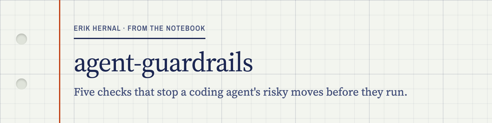

<picture>
  <source media="(prefers-color-scheme: dark)" srcset=".github/banner-dark.png">
  
</picture>

# agent-guardrails

Five small checks that run before an AI coding agent's command, plan or merge goes through, each one written after something went wrong.

[More on erikhernal.com](https://erikhernal.com/built/?utm_source=github)

## The problem

My coding agents write and ship most of my code, and the rules for them were written down. One still rebased its own branch and ran `git push --force-with-lease` without asking, because nothing checked the rule at the moment it mattered.

These are cut-down copies of checks that run on every command my coding agents make. Each is a Claude Code hook: it reads the tool call as JSON on stdin and exits 0 to let it through or 2 to block it, with the reason sent back to the agent.

## What it does

- `force-push-guard` blocks a force push in any spelling (`-f`, `-uf`, `--force-w`, `+branch`, `--mirror`). Written after an agent rebased and force-pushed its branch without asking.
- `branch-guard` blocks a commit when another session switched the branch, and warns once when someone else committed on it. Written after parallel sessions sharing one checkout switched the branch under each other, and one committed under the other.
- `protect-env` keeps `.env` files, SSH keys and other login files out of the agent's reads, so a key never lands in the chat. Written because a key that lands in a session log can't be taken back, and tightened after a review found `.env.local` and a credentials file had been readable all along.
- `exitplan-verification-check` blocks a plan that changes code but has no heading saying how it'll be proven. Written after a code plan got through whose only proof-like heading was "Verified while planning".
- `pr-review-gate` blocks a raw `gh pr merge`, so every merge goes through `bin/merge-reviewed.mjs`. The wrapper asks GitHub for the PR's head commit, needs a review from a second model family on that exact commit, and merges with `--match-head-commit`, so nothing pushed after the review gets in. Written after I measured that none of 11 branches one model wrote passed the other model's first review.

Each guard's header comment says what it doesn't catch. They read command text, so they catch honest mistakes, and a determined agent could still get around them.

## Demo

<!-- demo.gif goes here. Render it with: vhs demo.tape -->

## Run it yourself

You need Node 22 or newer. There are no dependencies, and nothing calls an AI model.

```sh
node demo.mjs                                                  # each guard gets one call to block and one to pass
node guards/force-push-guard.mjs < sample/force-push-blocked.json; echo "exit $?"   # one guard by hand: exit 2 is a block
npm test
```

The sample tool calls in `sample/` are made up, and every path in them starts with `/home/dev/project`.

To install all five:

```sh
mkdir -p ~/.claude/guards ~/.local/bin
cp guards/*.mjs ~/.claude/guards/
cp bin/merge-reviewed.mjs ~/.local/bin/merge-reviewed   # the merge wrapper, so ~/.local/bin needs to be on your PATH
# Merge the "hooks" block from settings.example.json into ~/.claude/settings.json.
# Then restart Claude Code.
```

## One real result

`test/exitplan-verification-check.test.mjs:18` replays the one real miss the private plan check found when 30 days of plans were reviewed. It was a code plan whose only proof-like heading was "## Verified while planning", which lists facts checked while planning and says nothing about how the change gets tested.

The guard blocks it, and the same test blocks "Validated facts" and "Tested paths" for the same reason.

## Where it came from

Pulled out of a private repo on 2026-11-25. The history stays private because it holds client data. The sample data is made up.

The private versions do more. The force-push guard accepts a one-time go from me for one branch and commit, the branch guard also checks for other live sessions in the same folder, and the merge gate checks the review against the reviewer's own transcript. Those parts lean on the rest of my setup, so they aren't here.

## Contact

erik@erikhernal.com

## License

MIT. See [LICENSE](LICENSE).
